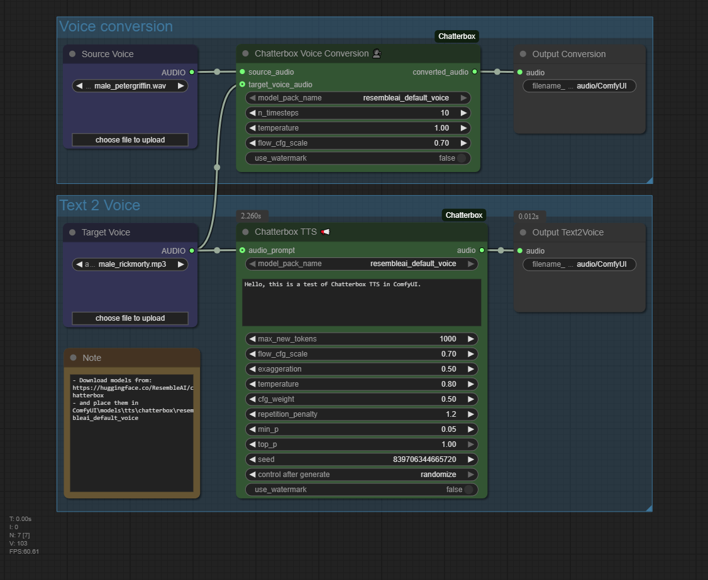

<!-- Improved compatibility of back to top link: See: https://github.com/othneildrew/Best-README-Template/pull/73 -->
<a id="readme-top"></a>

<br />
<div align="center">
  <a href="https://github.com/wildminder/ComfyUI-Chatterbox">
    
  </a>

  <h3 align="center">ComfyUI Chatterbox</h3>

  <p align="center">
    High-quality Text-to-Speech (TTS) and Voice Conversion (VC) nodes for ComfyUI, powered by Resemble AI's Chatterbox model.
    <br />
    <br />
    <a href="https://github.com/wildminder/ComfyUI-Chatterbox/issues/new?labels=bug&template=bug-report---.md">Report Bug</a>
    ·
    <a href="https://github.com/wildminder/ComfyUI-Chatterbox/issues/new?labels=enhancement&template=feature-request---.md">Request Feature</a>

<!-- PROJECT SHIELDS -->
[![Stargazers][stars-shield]][stars-url]
[![Issues][issues-shield]][issues-url]
[![Contributors][contributors-shield]][contributors-url]
[![Forks][forks-shield]][forks-url]
  </p>

</div>

<!-- TABLE OF CONTENTS -->
<details>
  <summary>Table of Contents</summary>
  <ol>
    <li><a href="#requirements">Requirements</a></li>
    <li><a href="#getting-started">Getting Started</a></li>
    <li>
      <a href="#usage">Usage</a>
      <ul>
        <li><a href="#nodes">Nodes</a></li>
        <li><a href="#node-parameters-explained">Node Parameters Explained</a></li>
        <li><a href="#models-and-model-packs">Models and model packs</a></li>
      </ul>
    </li>
    <li>
      <a href="#behaviour-worth-knowing">Behaviour worth knowing</a>
      <ul>
        <li><a href="#why-there-are-no-version-pins">Why there are no version pins</a></li>
        <li><a href="#offline-behaviour">Offline behaviour</a></li>
        <li><a href="#vram-characteristics">VRAM characteristics</a></li>
        <li><a href="#optional-extras">Optional extras</a></li>
      </ul>
    </li>
    <li><a href="#migrating-from-1x">Migrating from 1.x</a></li>
    <li><a href="#development">Development</a></li>
    <li><a href="#acknowledgments">Acknowledgments</a></li>
  </ol>
</details>

<!-- REQUIREMENTS -->
## Requirements

| | |
|---|---|
| **Python** | 3.10 or newer (`requires-python = ">=3.10"`; tested through 3.13) |
| **ComfyUI** | 0.37.0 or newer (`[tool.comfy] requires-comfyui = ">=0.37.0"`) — the V3 node API |
| **Accelerator** | CUDA, ROCm, XPU or MPS. The `device` widget is built from whatever ComfyUI itself offers, so the list always matches the running core. |
| **Disk** | ~2.5 GB per downloaded voice pack, under `ComfyUI/models/tts/chatterbox/`. |

The only packages this node adds to your environment are three pure-Python,
compiled-extension-free wheels:

```text
s3tokenizer
conformer
omegaconf
```

Everything else — `torch`, `torchaudio`, `transformers`, `huggingface_hub`,
`numpy`, `librosa`, `soundfile`, `safetensors`, `tokenizers`, `einops`, `scipy`,
`tqdm`, `accelerate` — is already part of a ComfyUI installation and is
deliberately **not** re-declared here. `diffusers` is not a dependency at all:
the vendored model code carries a small compatibility shim instead.

<p align="right">(<a href="#readme-top">back to top</a>)</p>

<!-- GETTING STARTED -->
## Getting Started

1. **Install via ComfyUI Manager (recommended):**
   * Search for `ComfyUI-Chatterbox` and install it.

2. **Manual installation:**

   ```bash
   cd ComfyUI/custom_nodes
   git clone https://github.com/wildminder/ComfyUI-Chatterbox.git
   pip install -r ComfyUI-Chatterbox/requirements.txt
   ```

3. **Restart ComfyUI.**

ComfyUI Manager runs step 2's `pip install` for you; it is spelled out here only
for a manual checkout. There is nothing else to fetch up front — the voice pack
is downloaded on first use.

<p align="right">(<a href="#readme-top">back to top</a>)</p>

<!-- USAGE -->
## Usage

<p align="right">(<a href="#readme-top">back to top</a>)</p>

### Nodes

All five nodes live in the `WMNodes/sound` category group (tts / vc / util sub-groups), in the Add-Node-menu order
below. Load a ready-made graph from
[`example_workflows/`](./example_workflows) to see them wired up.

| Node id | Menu name | Outputs | What it does |
|---|---|---|---|
| `ChatterboxTTS` | Chatterbox TTS 📢 | `audio` | Synthesises speech from text, optionally cloning a voice from a short audio prompt. One node for every TTS pack: classic, the Turbo family (Turbo 350M / Nano 110M), and Flash are routed automatically from the pack's contents, with paralinguistic tags and a top-k sampler for Turbo-family packs. |
| `ChatterboxMTLTTS` | Chatterbox Multilingual TTS 🌍 | `audio` | Synthesises speech in 23 languages with the multilingual model, in v1, v2 or v3. |
| `ChatterboxSRT` | Chatterbox SRT / Subtitles 📝 | `audio`, `generation_info`, `timing_report`, `Adjusted_SRT` | Speaks a timed SRT script and reconciles the model's actual timings with the file's, returning an adjusted subtitle file that matches the audio. |
| `ChatterboxDialog` | Chatterbox Multi-Speaker Dialog 🎭 | `dialog_audio`, `speaker_a_audio`, `speaker_b_audio`, `speaker_c_audio`, `speaker_d_audio`, `message` | Speaks a `SPEAKER A:` / `SPEAKER B:` conversation with a separate voice per speaker, returning the mixed dialog plus each speaker's isolated stem. |
| `ChatterboxVC` | Chatterbox Voice Conversion 🗣️ | `converted_audio` | Re-voices a source recording using a target voice. |

The implementation is split across two trees, and it is worth knowing which is
which before you go reading the source:

* **`nodes/`** — the ComfyUI surface. One module per node, plus `common.py` for
  the shared advanced widgets. This is the only tree that talks to `comfy_api`.
* **`src/chatterbox/`** — the vendored Resemble AI library. Kept as close to
  upstream as we can manage; every local edit is recorded in
  [`src/PATCHES.md`](./src/PATCHES.md) with a rationale. Re-syncing from upstream
  means taking upstream first and re-applying that patch layer.

> **Your existing workflows keep working.** Node ids and widget order are frozen;
> 2.0 changed the packaging underneath, not the surface. See
> [`CHANGELOG.md`](./CHANGELOG.md).

<p align="right">(<a href="#readme-top">back to top</a>)</p>

### Node Parameters Explained

#### Chatterbox TTS 📢

  * **`model_pack_name`**: the voice pack to speak with. The list is your models
    directory, read live.
  * **`text`**: what to say.
  * **`max_new_tokens`**: audio-token budget, and a failsafe against run-on
    generations. ~25 tokens is about one second of audio; the model's hard limit
    is 4096 tokens (~163 seconds).
  * **`flow_cfg_scale`**: CFG scale for the mel spectrogram decoder. Higher values
    increase adherence to the text and to the speaker's timbre, and may cost
    naturalness.
  * **`exaggeration`**: expressiveness and emotional intensity.
  * **`temperature`**: randomness of *token sampling*. Higher is more varied and
    less repeatable.
  * **`cfg_weight`**: classifier-free guidance weight for token sampling.
  * **`repetition_penalty`**: discourages repeated tokens. `1.0` is no penalty.
  * **`min_p` / `top_p`**: nucleus sampling bounds on the candidate token pool.
  * **`seed`**: with its usual `control_after_generate` companion.
  * **`use_watermark`**: embeds an audio watermark. Requires the `watermarking`
    extra; without it the node still runs and produces un-watermarked audio.
  * **`audio_prompt`** (optional): a short reference clip whose voice is cloned.

#### Chatterbox Voice Conversion 🗣️

  * **`source_audio`**: the recording to re-voice.
  * **`n_timesteps`**: diffusion steps for the flow matching. More is smoother and
    slower.
  * **`temperature`**: randomness of the initial noise. `1.0` is standard.
  * **`flow_cfg_scale`**: as above, applied to the target voice's timbre.
  * **`use_watermark`**: as above.
  * **`target_voice_audio`** (optional): the voice to convert *to*. Omit it and
    the pack's default voice is used.

#### Both nodes above: the advanced widgets

Three widgets sit after the frozen block. They are appended, not inserted — the
original widget order is untouched — and leaving them at their defaults gives you
1.x behaviour.

  * **`device`**: `auto`, a specific accelerator, or `cpu`.
  * **`dtype`**: `auto`, `fp32`, `fp16`, `bf16`. `auto` asks the device what it
    supports, which is what you want unless you have a reason to override it.
  * **`attention_mode`**: `sdpa`, `flash` or `sage` — only the ones this machine
    actually supports are offered, and an unavailable one falls back to `sdpa`.

<p align="right">(<a href="#readme-top">back to top</a>)</p>

### Models and model packs

A *voice pack* is a directory holding one Chatterbox model. The default pack,
`resembleai_default_voice`, is downloaded automatically on first use from
`ResembleAI/chatterbox` and lands in:

```text
ComfyUI/models/tts/chatterbox/resembleai_default_voice/
```

Anything you drop into `ComfyUI/models/tts/chatterbox/<your-pack>/` is picked up
and offered in the `model_pack_name` dropdown on the next start. Chatterbox
registers its `chatterbox` folder under *every* `tts` root ComfyUI resolves, so a
pack installed under a secondary root from `extra_model_paths.yaml` is visible
too.

What a pack *is* is read from the t3 checkpoint it carries, not from its
folder name, and pairing is validated at load time, before anything is
downloaded:

- **Turbo-family packs** (`t3_turbo_v1.safetensors` / `t3_nano_v1.safetensors`)
  load through the same **Chatterbox TTS 📢** node as classic packs -- no switch
  to set. The two repos (`ResembleAI/chatterbox-turbo` and its smaller member
  `ResembleAI/chatterbox-nano`) share every weight except the t3 checkpoint, so
  both download into the **one** `chatterbox-turbo/` folder, and the dropdown
  offers it twice: `chatterbox-turbo` (Turbo) and `chatterbox-turbo-nano`
  (Nano). Which weights load is decided by the entry you pick, not by the
  folder. Nano's tokenizer ships as `vocab.json` + `merges.txt` rather than
  `tokenizer.json`; both layouts load.
- **Flash packs** (`t3_flash.safetensors`, `ResembleAI/chatterbox-flash`) are a
  block-diffusion model whose sampler lives in the separate
  [`chatterbox-flash`](https://pypi.org/project/chatterbox-flash/) pip package.
  Install it **without** its dependency block (it would pull an old `chatterbox`
  that shadows this node's vendored tree):
  `python -m pip install --no-deps chatterbox-flash`.
  Flash loads through the same **Chatterbox TTS 📢** node and has no built-in
  voice — connect a reference audio clip to the node's audio prompt input.
  `exaggeration` and `temperature` apply; the classic sampler's knobs
  (`cfg_weight`, `min_p`, `top_k`, watermarking) do not.
- Classic packs (`t3_cfg.safetensors`) are the voice-conversion packs too.

Folders from earlier builds named like a pack plus a variant
(`chatterbox-nano__turbo`) are ordinary packs as far as the scanner is
concerned and keep loading; rename or delete them at will.

<p align="right">(<a href="#readme-top">back to top</a>)</p>

<!-- BEHAVIOUR -->
## Behaviour worth knowing

<p align="right">(<a href="#readme-top">back to top</a>)</p>

### Why there are no version pins

Neither `requirements.txt` nor `pyproject.toml` pins a single version. That is a
decision, not an oversight.

ComfyUI is the host environment, and ComfyUI Manager reconciles a custom node's
declared dependencies against what the host already has. **A pin in a custom node
is an instruction to change the host's package.** Declaring `torch==2.4.0`
because that is what we tested against would have Manager replace the user's
carefully chosen CUDA build with a generic PyPI wheel — on the wrong CUDA
runtime, if not outright broken. The same argument applies one level down: every
upstream package we pin is another chance to downgrade something in a working
install in order to satisfy a dependency that almost certainly already satisfied
it.

So the contract is: **declare what you add, never what you depend on.** `torch`,
`torchaudio`, `transformers`, `huggingface_hub`, `numpy`, `librosa`, `soundfile`,
`safetensors`, `tokenizers`, `einops`, `scipy`, `tqdm` and `accelerate` come from
ComfyUI. We add three pure-Python wheels, and our test suite asserts that nothing
else creeps back in.

<p align="right">(<a href="#readme-top">back to top</a>)</p>

### Offline behaviour

**A local model directory is never re-downloaded.** Before touching the network,
the loader asks whether the pack directory is already complete — the expected
weight files are present and readable — and if it is, generation proceeds with no
network access at all.

The network is therefore touched for exactly one reason: a **first-run download**
of a pack that is not on disk yet. That download is resumable, reports per-file
progress to the ComfyUI frontend, and writes partial files as `*.incomplete` so
an interrupted transfer can never be mistaken for a finished pack. Once it
completes, no later run reaches the network — not on a re-run, not after a
restart.

<p align="right">(<a href="#readme-top">back to top</a>)</p>

### VRAM characteristics

The stack is loaded through ComfyUI's own model-patching system, so it takes part
in the same VRAM management as the rest of your workflow:

* **The size is measured, not assumed.** Before load, the packer sums the actual
  bytes of the pack's `*.safetensors` files on disk. After load, the estimate is
  refined from the parameters the loaded module really holds. No hard-coded
  budget to drift away from reality.
* **Full load or partial load.** If the pack plus about 1.5 GB of activation
  headroom fits in free VRAM, it is loaded whole. If it does not, ComfyUI loads
  it partially and reports `loaded partially; … MB offloaded`, so the numbers you
  see are measured rather than estimated.
* **Warm offload, then release.** A cold offload moves the pack to system RAM; a
  *warm* offload keeps the loaded weights available to the next node while
  telling core they are no longer resident. Either way, the node drops its
  references to both the TTS and the VC model when the execution ends, so a long
  workflow does not accumulate one resident copy per run.
* **One cache, keyed by resolved model identity** — pack name, attention mode,
  dtype, device. A second browser tab asking for the same model gets the loaded
  weights rather than a second copy.

<p align="right">(<a href="#readme-top">back to top</a>)</p>

### Optional extras

None of these are required. Each unlocks one feature and degrades gracefully when
absent.

| Extra | Installs | Unlocks |
|---|---|---|
| `watermarking` | `resemble-perth` | `use_watermark` produces watermarked audio. Without it the node runs and outputs plain audio. |
| `multilingual` | `pykakasi`, `spacy-pkuseg` | CJK and Korean segmentation for the multilingual node. |
| `turbo` | `pyloudnorm` | Loudness normalisation for Turbo-family packs. |

```bash
pip install "ComfyUI-ChatterboxTTS[watermarking]"
```

The watermarking import is defensive *inside the vendored code itself*, which is
why the node never crashes on a machine without `resemble-perth`.

There is deliberately **no `[flash]` extra**. A normal pip install of
`chatterbox-flash` also installs its dependency block, which pulls an old
`chatterbox` package over this node's vendored tree. Install it by hand, without
dependencies, into the Python environment ComfyUI runs on:

```bash
python -m pip install --no-deps chatterbox-flash
```

```bash
pip install "ComfyUI-ChatterboxTTS[watermarking]"
```

The watermarking import is defensive *inside the vendored code itself*, which is
why the node never crashes on a machine without `resemble-perth`.

<p align="right">(<a href="#readme-top">back to top</a>)</p>

<!-- MIGRATION -->
## Migrating from 1.x

**Your node ids and your widget order did not change.** Every workflow you have
already saved still loads and still binds the same values to the same widgets.
2.0.0 is a breaking change in the *packaging* only — see
[`CHANGELOG.md`](./CHANGELOG.md).

One thing did move on disk.

> [!IMPORTANT]
> **If you used Chatterbox 1.0 or 1.1, delete this folder by hand:**
>
> ```text
> ComfyUI/models/chatterbox_tts/
> ```
>
> It is no longer read, and nothing migrates it for you. Downloads now go to
> the ComfyUI-standard location `ComfyUI/models/tts/chatterbox/`, and leaving the
> old folder around only wastes disk and invites confusion about which one is
> live. **No compatibility shim is provided**, and none is planned: a shim that
> silently re-homed several gigabytes of your models would be a worse surprise
> than a clear instruction.

> [!TIP]
> You do not have to re-download anything you already have — move or copy the
> contents of `models/chatterbox_tts/<pack>/` into
> `models/tts/chatterbox/<pack>/` before starting and the node will find the pack
> where it stands.

<p align="right">(<a href="#readme-top">back to top</a>)</p>

<!-- DEVELOPMENT -->
## Development

```bash
COMFYUI_ROOT=/path/to/ComfyUI python -m pytest tests/ -q -rs
```

`COMFYUI_ROOT` must point at a real ComfyUI checkout. `comfy` and
`folder_paths` are imported for real, because these are ComfyUI nodes and a fake
ComfyUI would test nothing. The suite mocks the vendored model stack, so it runs
on a machine with no model weights and no GPU.

[`src/PATCHES.md`](./src/PATCHES.md) is the current local patch layer over
upstream; re-syncing from upstream means taking upstream first and re-applying
it entry by entry.

<p align="right">(<a href="#readme-top">back to top</a>)</p>

<!-- ACKNOWLEDGMENTS -->
## Acknowledgments

*   This node would not be possible without the incredible [Chatterbox](https://github.com/resemble-ai/chatterbox) library by **Resemble AI**.
*   README template adapted from the [Best-README-Template](https://github.com/othneildrew/Best-README-Template).

<p align="right">(<a href="#readme-top">back to top</a>)</p>

<!-- MARKDOWN LINKS & IMAGES -->
[contributors-shield]: https://img.shields.io/github/contributors/wildminder/ComfyUI-Chatterbox.svg?style=for-the-badge
[contributors-url]: https://github.com/wildminder/ComfyUI-Chatterbox/graphs/contributors
[forks-shield]: https://img.shields.io/github/forks/wildminder/ComfyUI-Chatterbox.svg?style=for-the-badge
[forks-url]: https://github.com/wildminder/ComfyUI-Chatterbox/network/members
[stars-shield]: https://img.shields.io/github/stars/wildminder/ComfyUI-Chatterbox.svg?style=for-the-badge
[stars-url]: https://github.com/wildminder/ComfyUI-Chatterbox/stargazers
[issues-shield]: https://img.shields.io/github/issues/wildminder/ComfyUI-Chatterbox.svg?style=for-the-badge
[issues-url]: https://github.com/wildminder/ComfyUI-Chatterbox/issues